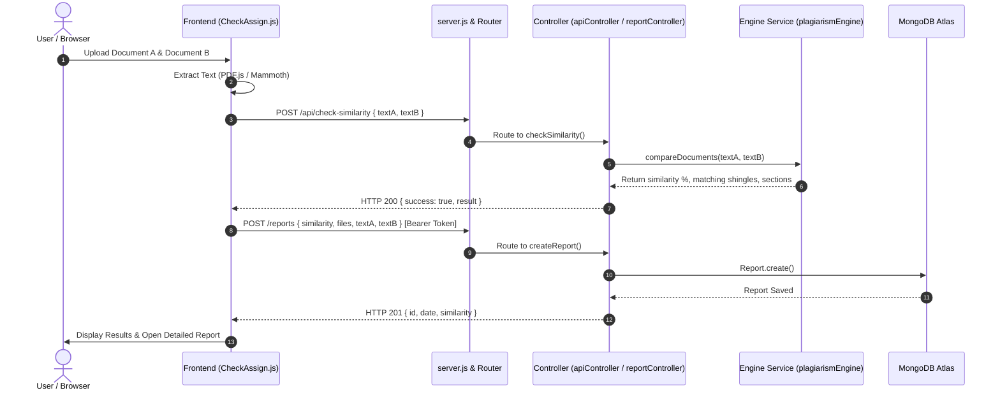

# AssignCheck — Project Folder & System Architecture

Is document mein pooray **AssignCheck** project ka folder structure, file architecture, MVC pattern aur data flow detail mein explain kiya gaya hai.

---

## 🌳 Complete Directory & File 

Tree

```
Assignment-Plagiarism/
│
├── .env                                 # Environment variables (PORT, MONGODB_URI, JWT_SECRET)
├── .env.example                         # Template for environment variables
├── .gitignore                           # Git ignore rules (node_modules, .env, etc.)
├── ARCHITECTURE.md                      # Complete system & folder architecture documentation
├── PROJECT_EVALUATION.md                # Project audit & evaluation notes
├── README.md                            # Project overview, installation & features
├── db.json                              # Initial local seed database (migrated to MongoDB)
├── index.html                           # Root redirector to /src/Frontend/Templates/index.html
├── package.json                         # Dependencies, metadata & test scripts
├── package-lock.json                    # Locked dependency tree
├── server.js                            # Express bootstrap (<60 lines): mounts routes, DB & static files
│
├── Assets/                              # Static visual media & screenshots
│   └── Screenshots/                     # UI screenshots & visual diagrams
│       ├── banner.jpg
│       ├── history.jpeg
│       ├── home.jpeg
│       ├── how_it_works.jpg
│       ├── profile.jpeg
│       ├── result.jpeg
│       ├── studentstudent.jpeg
│       └── teacherstudent.jpeg
│
├── scripts/                             # Utility & database maintenance scripts
│   └── sanitize-db.js                   # Sanitizes and rehashes passwords in db.json
│
├── tests/                               # Automated Test Suites
│   ├── api.test.js                      # End-to-end API test suite (16 tests, HTTP requests)
│   ├── plagiarismEngine.test.js         # Plagiarism engine & spellcheck unit tests (41 tests)
│   └── test_upload_flow.js              # File extraction & drag-and-drop validation (3 tests)
│
└── src/                                 # Main Source Code
    │
    ├── Frontend/                        # 🎨 PRESENTATION TIER (HTML, CSS, Client Scripts)
    │   │
    │   ├── Templates/                   # HTML Pages (Views)
    │   │   ├── index.html               # Landing page, feature highlights, login/signup modals
    │   │   ├── CheckAssign.html         # Main document comparison & plagiarism checking page
    │   │   ├── DetailedReport.html      # Side-by-side text diff, shingle matches & typo highlights
    │   │   ├── history.html             # Past comparison history & download report options
    │   │   └── profile.html             # User profile, statistics & document audit records
    │   │
    │   ├── styles/                      # CSS Stylesheets
    │   │   ├── index.css                # Home page styling, hero section, modals, responsive grid
    │   │   ├── checkAssign.css          # Upload boxes, progress bar, action buttons, score gauges
    │   │   ├── detailedReport.css       # Diff viewer, side-by-side panels, match highlights
    │   │   ├── history.css              # History cards, filter tabs, modal dialogs
    │   │   ├── profile.css              # Profile cards, user stats, security settings
    │   │   └── certificate.css          # Plagiarism report certificate styling & print layouts
    │   │
    │   └── Scripts/                     # Client-side JavaScript
    │       ├── config.js                # Auto-detects environment (Localhost vs Render Deployed URL)
    │       ├── toast.js                 # Toast notifications & confirmation dialogs
    │       ├── CheckAssign.js           # Core document extraction (PDF/DOCX), pre-filtering & API call
    │       ├── CheckBackend.js          # Text preprocessing helpers, file readers & token sanitizers
    │       ├── HomeDesign.js            # Landing page UI interactions, navbar, smooth scroll
    │       ├── HomeBackend.js           # Client-side auth helpers, token management, session storage
    │       ├── Homesignup.js            # Login/Register form validation & submission
    │       ├── history.js               # History page data fetching, rendering & report deletions
    │       ├── detailedReport.js        # Detailed report viewer logic & visual highlights
    │       ├── profile.js               # Profile page dashboard loader & user settings update
    │       ├── SpellChecker.js          # Client-side typo highlighter & phrase extraction
    │       └── certificateModal.js      # Certificate generator & printable modal
    │
    └── Backend/                         # ⚙️ BACKEND (Pure MVC Architecture)
        │
        ├── Config/                      # 🔌 Database & Environment Config
        │   └── db.js                    # MongoDB Atlas connection, seed migration & password re-hash
        │
        ├── Models/                      # 🗄️ M - MODELS (Mongoose Schemas)
        │   ├── User.js                  # User schema: name, email, bcrypt password, role (student/teacher/admin)
        │   ├── Report.js                # Report schema: files, similarity %, sections, phrases, typos, date
        │   ├── FileData.js              # FileData schema: user uploaded file metadata
        │   ├── FileResult.js            # FileResult schema: processed document audit logs
        │   └── index.js                 # Barrel export for all 4 models
        │
        ├── Controllers/                 # 🧠 C - CONTROLLERS (Business & API Logic)
        │   ├── authController.js        # Handles: register, login, verifyToken, changePassword, resetPassword
        │   ├── userController.js        # Handles: getUsers, getUserById, updateUser
        │   ├── reportController.js      # Handles: getReports, getReportById, createReport, deleteReport
        │   ├── fileDataController.js    # Handles: getFileData, createFileData, updateFileData
        │   ├── fileResultController.js  # Handles: getFileResult, createFileResult, updateFileResult
        │   └── apiController.js         # Handles: getHealth, checkSimilarity, spellCheck, userProfileSummary
        │
        ├── Routes/                      # 🛣️ ROUTES (Express Route Mappings)
        │   ├── authRoutes.js            # POST /users, POST /login, GET /auth/verify, POST /auth/*
        │   ├── userRoutes.js            # GET /users, GET /users/:id, PUT /users/:id
        │   ├── reportRoutes.js          # GET /reports, GET /reports/:id, POST /reports, DELETE /reports/:id
        │   ├── fileDataRoutes.js        # GET /filedata, POST /filedata, PUT /filedata/:id
        │   ├── fileResultRoutes.js      # GET /fileresult, POST /fileresult, PUT /fileresult/:id
        │   ├── apiRoutes.js             # GET /api/health, POST /api/check-similarity, POST /api/spellcheck
        │   └── index.js                 # Central Router aggregating and mounting all route modules
        │
        ├── Middleware/                  # 🛡️ MIDDLEWARE
        │   ├── auth.js                  # authenticateToken (strict JWT), optionalToken, requireRole (RBAC)
        │   └── rateLimiter.js           # generalLimiter (DDoS protection), authLimiter (brute-force defense)
        │
        └── Services/                    # 🔬 CORE ENGINES & ALGORITHMS
            ├── plagiarismEngine.js      # Sliding n-gram shingling, Jaccard similarity & symmetric diffs
            └── spellCheckService.js     # Server-side dynamic spell checking via nspell dictionary
```

---

## 🏛️ Architecture Breakdown (MVC Pattern)

### 1. Model (Data Layer) — `src/Backend/Models/`
- MongoDB Atlas ke collection schemas define karta hai.
- Sensitive fields (`password`, `resetToken`) ko sanitize karne ke liye `formatDoc` helper use hota hai.
- Unique custom ID generator `id` virtual getter provide karta hai.

### 2. View (Presentation Layer) — `src/Frontend/`
- **Templates:** HTML5 semantic structure aur UI views (`index.html`, `CheckAssign.html`, etc.).
- **Styles:** Pure Vanilla CSS jo sleek dark mode, glassmorphism, responsive cards aur visual meters provide karti hai.
- **Scripts:** Browser-level scripts jo files extract karti hain aur backend API endpoints ko call karti hain.

### 3. Controller (Logic Layer) — `src/Backend/Controllers/`
- Request validation, business logic, DB queries aur response formatting handle karte hain.
- Direct database models se communicate karte hain aur routes ko clean rakhte hain.

### 4. Router (Dispatch Layer) — `src/Backend/Routes/`
- Clean URL mapping provide karte hain.
- Har route par required middleware apply karte hain (e.g., `authenticateToken`, `authLimiter`).

---

## 🔄 Request & Data Flow Diagram



---

## 📡 API Endpoints Reference

| Route | HTTP Method | Middleware | Controller Action | Description |
|---|:---:|---|---|---|
| `/api/health` | `GET` | — | `apiController.getHealth` | Server & DB health check |
| `/users` | `POST` | `authLimiter` | `authController.register` | New user registration |
| `/login` | `POST` | `authLimiter` | `authController.login` | Authenticate & get JWT token |
| `/auth/verify` | `GET` | `authenticateToken` | `authController.verifyToken` | Verify active session |
| `/auth/change-password` | `POST` | `authenticateToken` | `authController.changePassword` | Change user password |
| `/auth/forgot-password` | `POST` | `authLimiter` | `authController.forgotPassword` | Request password reset |
| `/auth/reset-password` | `POST` | `authLimiter` | `authController.resetPassword` | Complete password reset |
| `/api/check-similarity` | `POST` | `optionalToken` | `apiController.checkSimilarity` | Authoritative plagiarism check |
| `/api/spellcheck` | `POST` | `optionalToken` | `apiController.spellCheck` | Dynamic spell checking |
| `/api/user-profile-summary`| `GET` | `authenticateToken` | `apiController.getUserProfileSummary`| Ultra-fast unified profile data |
| `/reports` | `GET` | `authenticateToken` | `reportController.getReports` | Get user comparison reports |
| `/reports` | `POST` | `optionalToken` | `reportController.createReport` | Save comparison report |
| `/reports/:id` | `GET` | `authenticateToken` | `reportController.getReportById` | Get single report details |
| `/reports/:id` | `DELETE` | `authenticateToken` | `reportController.deleteReport` | Delete report by ID |
| `/filedata` | `GET` / `POST` | `authenticateToken` | `fileDataController` | Uploaded document metadata |
| `/fileresult` | `GET` / `POST` | `authenticateToken` | `fileResultController` | Processing audit log entries |

---

## 🧪 Testing Commands

```bash
# 1. Start Dev Server locally
npm run dev

# 2. Run Plagiarism Engine algorithm unit tests (41 tests)
npm test

# 3. Run End-to-End Backend API tests (16 tests)
npm run test:api

# 4. Run All tests together (57 tests)
npm run test:all
```
