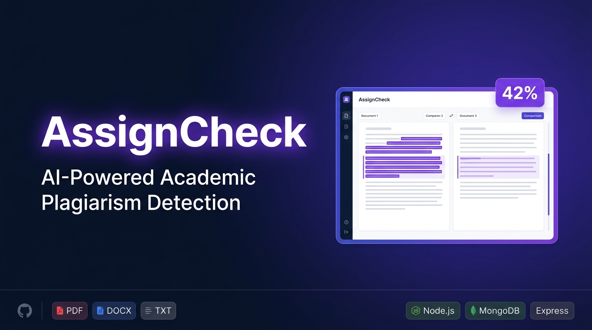
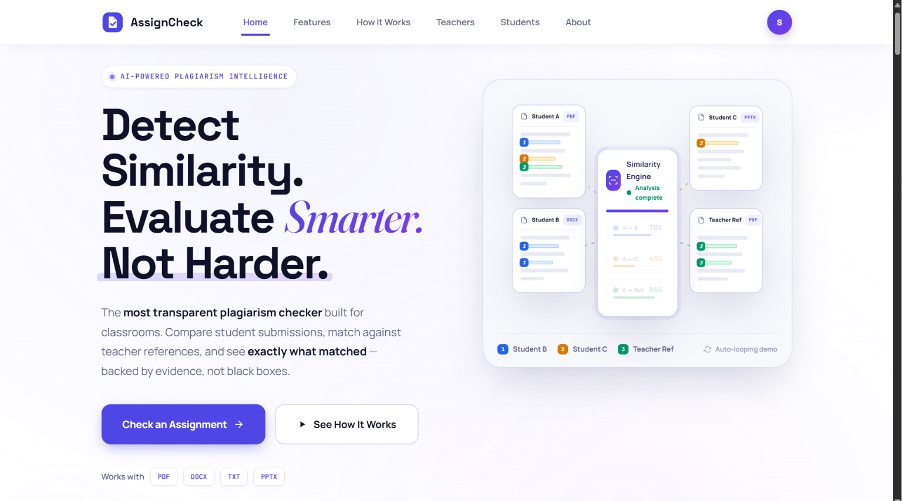
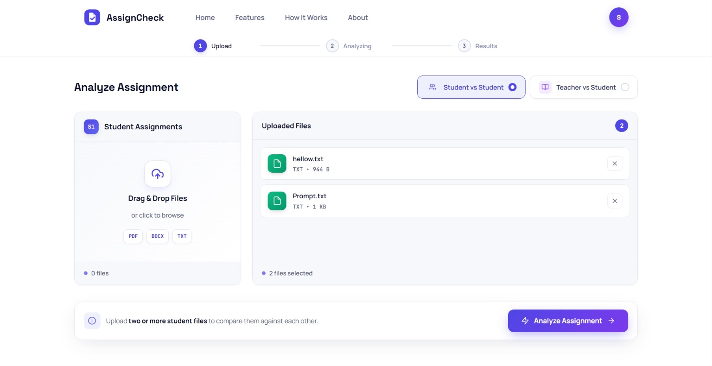
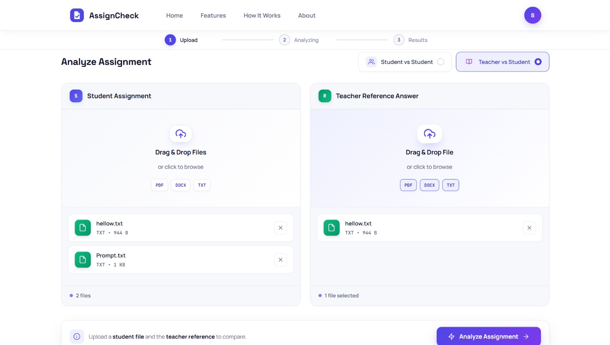
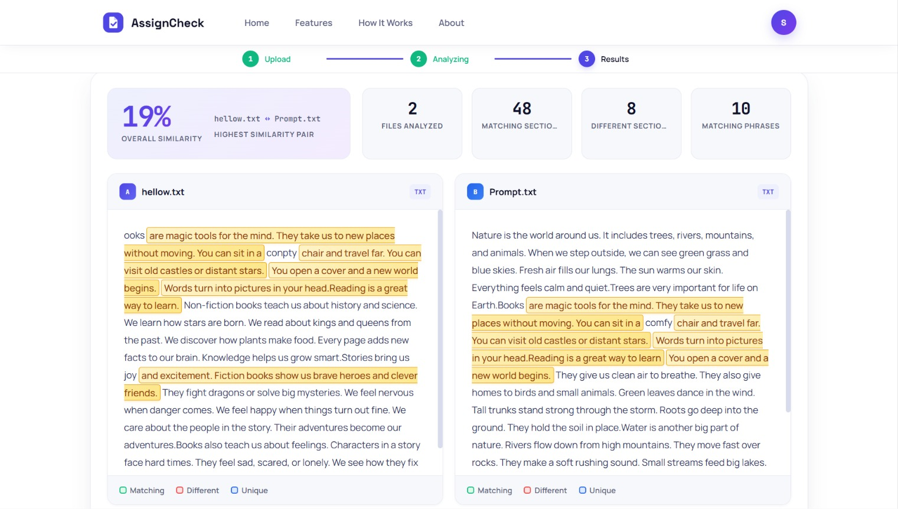
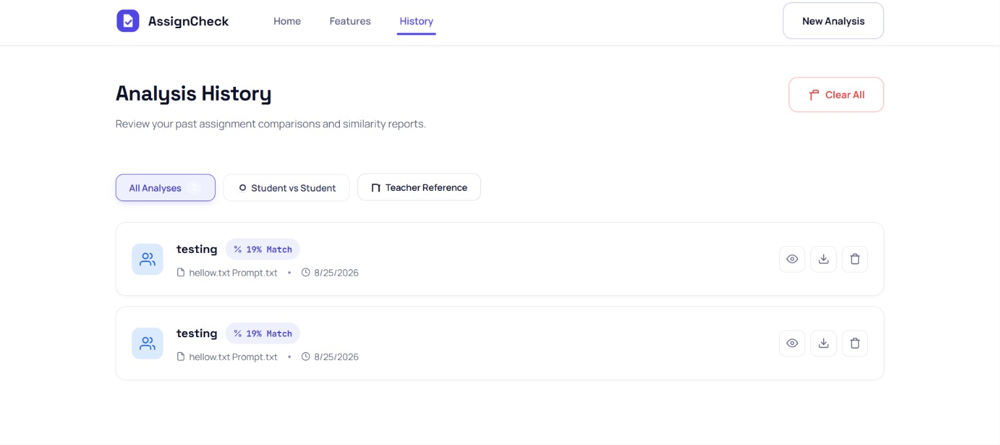
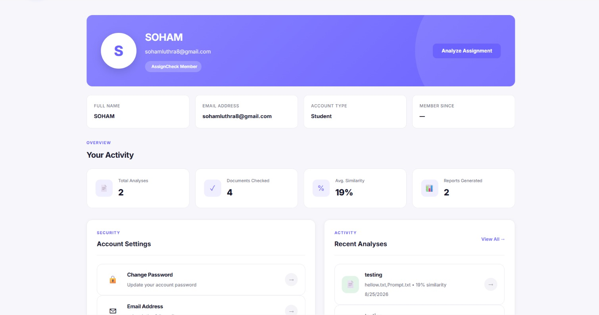
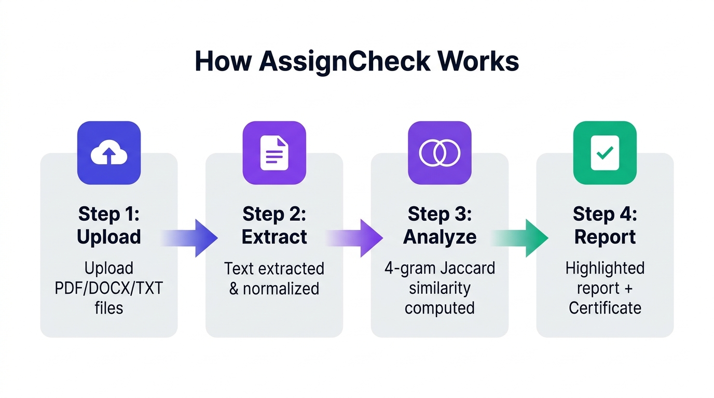

<div align="center">



<br/>

<!-- Animated Typing -->
<a href="https://git.io/typing-svg">
  
</a>

<br/><br/>

<!-- Badges Row 1 -->
[](https://assignment-plagarism-2.onrender.com)
[](https://github.com/yashika-34/Assignment-Plagarism/stargazers)
[](https://github.com/yashika-34/Assignment-Plagarism/forks)

<br/>

<!-- Badges Row 2 -->
[](https://nodejs.org)
[](https://expressjs.com)
[](https://mongodb.com/atlas)
[](https://jwt.io)
[](https://render.com)
[](./tests)
[](https://github.com/yashika-34/Assignment-Plagarism/pulls)

<br/>

> **The most transparent plagiarism checker built for classrooms.**  
> Compare student submissions, match against teacher references, and see **exactly what matched** — backed by evidence, not black boxes.

<br/>

[**🚀 Try Live Demo**](https://assignment-plagarism-2.onrender.com) &nbsp;·&nbsp; [**📖 Documentation**](#-local-setup) &nbsp;·&nbsp; [**🐛 Report Bug**](https://github.com/yashika-34/Assignment-Plagarism/issues) &nbsp;·&nbsp; [**✨ Request Feature**](https://github.com/yashika-34/Assignment-Plagarism/issues)

</div>

---

## 📸 Screenshots

<div align="center">

### 🏠 Landing Page


<br/><br/>

### 📤 Upload & Compare

<table>
<tr>
<td width="50%">
<b>Student vs Student Mode</b><br/>

</td>
<td width="50%">
<b>Teacher vs Student Mode</b><br/>

</td>
</tr>
</table>

<br/>

### 📊 Analysis Results — Side-by-Side Diff View


<br/><br/>

### 📚 History &nbsp;&nbsp;&nbsp; 👤 Profile Dashboard

<table>
<tr>
<td width="50%">

</td>
<td width="50%">

</td>
</tr>
</table>

</div>

---

## ⚙️ How It Works

<div align="center">

</div>

---

## ✨ Features

<div align="center">

| 🔍 Core Detection | 📊 Reporting | 🔐 Security |
|:---|:---|:---|
| Student ↔ Student pairwise | Side-by-side diff viewer | JWT Bearer authentication |
| Teacher → Student evaluation | Color-coded text highlights | bcrypt password hashing |
| Classroom batch mode (N files) | Downloadable PDF report | Role-based access control |
| Symmetric Jaccard algorithm | 🎖️ Originality certificate + QR | Rate limiting (30 req/15min) |
| Typo-tolerant fuzzy matching | Analysis history per user | Server-side score validation |
| Peer collusion matrix | Profile stats dashboard | XSS-safe DOM rendering |

</div>

---

## 🛠️ Tech Stack

<div align="center">

### Frontend
[](https://developer.mozilla.org/en-US/docs/Web/HTML)
[](https://developer.mozilla.org/en-US/docs/Web/CSS)
[](https://developer.mozilla.org/en-US/docs/Web/JavaScript)

### Backend & Database
[](https://nodejs.org)
[](https://expressjs.com)
[](https://mongodb.com)

### Tools & Deploy
[](https://github.com)
[](https://render.com)

</div>

<br/>

<details>
<summary><b>📦 Full dependency list</b></summary>

<br/>

| Package | Version | Purpose |
|---|---|---|
| `express` | 5.x | REST API server |
| `mongoose` | 9.x | MongoDB ORM |
| `bcrypt` | 6.x | Password hashing |
| `jsonwebtoken` | 9.x | JWT authentication |
| `express-rate-limit` | 8.x | Brute-force protection |
| `dotenv` | 18.x | Environment variables |
| `nspell` | 2.x | Spell check engine |
| `dictionary-en` | 4.x | English word dictionary |

</details>

---

## 📂 Project Structure

<details>
<summary><b>🗂️ Click to expand full file tree</b></summary>

```text
Assignment-Plagiarism/
│
├── 📄 server.js                        # Express bootstrap (< 70 lines)
├── 📄 render.yaml                      # Render.com auto-deploy config
├── 📄 package.json                     # Scripts & dependencies
│
├── 📁 src/Backend/
│   ├── Config/db.js                    # MongoDB Atlas connection
│   ├── Controllers/                    # MVC: api, auth, reports, filedata, users
│   ├── Middleware/                     # JWT auth, rate limiter
│   ├── Models/                         # Mongoose: User, Report, FileData
│   ├── Routes/                         # Express route registration
│   └── Services/
│       ├── plagiarismEngine.js         # ⭐ Jaccard + fuzzy typo alignment
│       └── spellCheckService.js        # Server-side spell checker
│
├── 📁 src/Frontend/
│   ├── Templates/                      # HTML pages
│   │   ├── index.html                  # Landing page + auth modals
│   │   ├── CheckAssign.html            # File upload & comparison
│   │   ├── DetailedReport.html         # Side-by-side diff report
│   │   ├── history.html                # Analysis history
│   │   └── profile.html                # User profile + settings
│   ├── styles/                         # CSS (6 stylesheets)
│   └── Scripts/
│       ├── CheckAssign.js              # ⭐ Main checker logic
│       ├── CheckBackend.js             # File extraction + local Jaccard
│       ├── detailedReport.js           # Report viewer + PDF export
│       ├── certificateModal.js         # 🎖️ Certificate generator + QR
│       ├── history.js                  # History page logic
│       ├── profile.js                  # Profile dashboard
│       ├── SpellChecker.js             # Client-side typo detection
│       └── toast.js                    # Toast notification system
│
├── 📁 tests/
│   ├── plagiarismEngine.test.js        # 41 engine unit tests ✅
│   ├── test_upload_flow.js             # 3 file extraction tests ✅
│   └── api.test.js                     # 16 API integration tests ✅
│
└── 📁 Assets/
    └── Screenshots/                    # UI screenshots & visual diagrams
```

</details>

---

## ⚙️ Local Setup

### Prerequisites

- **Node.js v18+** → [nodejs.org](https://nodejs.org)
- **MongoDB** (local or [Atlas cloud](https://mongodb.com/atlas))

### Quick Start

```bash
# 1. Clone
git clone https://github.com/yashika-34/Assignment-Plagarism.git
cd Assignment-Plagarism

# 2. Install
npm install

# 3. Configure
copy .env.example .env
```

Edit `.env`:
```env
PORT=3000
MONGODB_URI=mongodb://127.0.0.1:27017/assigncheck
JWT_SECRET=your_long_random_secret_here_min_32_chars
```

```bash
# 4. Run
npm start
```

🌐 Open **[http://localhost:3000](http://localhost:3000)**

---

## 🧪 Tests

```bash
npm test              # 41 plagiarism engine unit tests
npm run test:upload   # 3 file extraction & validation tests
npm run test:api      # 16 API integration tests
npm run test:all      # All 60 automated tests ✅
```

<details>
<summary><b>📋 What's tested</b></summary>

- ✅ Text normalization & tokenization
- ✅ Shingle generation (edge cases: short, empty, unicode)
- ✅ **Symmetry**: `Sim(A,B) === Sim(B,A)` — mathematically verified
- ✅ Identical / unrelated / partially overlapping documents  
- ✅ Fuzzy typo alignment (Levenshtein ≤ 2)
- ✅ Filter options: exclude quotes, references, small matches
- ✅ Server-side score validation (spoofing prevention)
- ✅ Auth flow: register → login → JWT → protected routes
- ✅ Report save, fetch, delete (with ownership check)

</details>

---

## 🔐 Security

<details>
<summary><b>🛡️ Security model</b></summary>

| Feature | Implementation |
|---|---|
| Password storage | bcrypt hashed (10 rounds), never plain text |
| Authentication | JWT Bearer tokens (7-day expiry) |
| Password reset | 6-digit time-limited OTP (15 min) |
| Student isolation | Students access **only their own** reports |
| Teacher access | Full report + user data visibility |
| Score integrity | Server **recalculates** from raw text — ignores client scores |
| XSS prevention | File names via `.textContent`, never `innerHTML` |
| Rate limiting | 30 auth / 15 min • 500 general / 15 min |

</details>

---

## 📐 Algorithm

<details>
<summary><b>🔬 Symmetric Jaccard Similarity explained</b></summary>

AssignCheck splits each document into **4-word sliding shingles**, then computes:

```
Similarity(A, B) = |shingles(A) ∩ shingles(B)|  ×  100%
                   ─────────────────────────────
                   |shingles(A) ∪ shingles(B)|
```

**Guaranteed symmetric**: `Sim(A, B)` always equals `Sim(B, A)`.

### Typo-Tolerant Matching
Words with Levenshtein distance ≤ 1 (short) or ≤ 2 (long) are fuzzy-aligned before shingling — spelling mistakes still count toward similarity.

### Directional Coverage
```
A→B coverage = |A ∩ B| / |A|  ×  100%   (how much of A is in B)
B→A coverage = |A ∩ B| / |B|  ×  100%   (how much of B is in A)
```

### Performance (Batch Mode)
- Student-vs-teacher: **parallel batches of 3** (no waiting)
- Peer collusion matrix: **instant local Jaccard** (zero API calls)

</details>

---

## 🚀 Deploy on Render

```yaml
# render.yaml is already included — just connect your repo!
```

1. Fork this repo
2. [dashboard.render.com](https://dashboard.render.com) → **New Web Service**
3. Connect `yashika-34/Assignment-Plagarism`
4. Add environment variables:

| Key | Value |
|---|---|
| `MONGODB_URI` | Your MongoDB Atlas URI |
| `JWT_SECRET` | A long random string |

5. Click **Deploy** ✅ — auto-deploys on every push to `main`

---

## 🎭 Demo Accounts

| Role | Email | Password |
|---|---|---|
| 👨‍🏫 Teacher | `teacher@example.edu` | `Teacher123!` |
| 👨‍🎓 Student | `student@example.edu` | `Student123!` |

---

## 📋 Supported File Formats

<div align="center">

| Format | Extraction | Max Size |
|:---:|:---:|:---:|
| `.txt` | Native `File.text()` API | 50 MB |
| `.pdf` | PDF.js text layer | 50 MB |
| `.docx` | Mammoth.js | 50 MB |

> ⚠️ Scanned PDFs (image-only, no text layer) return 0% similarity

</div>

---

<div align="center">

### ⭐ If you find this useful, give it a star!

[](https://github.com/yashika-34/Assignment-Plagarism/stargazers)

---

**Made with ❤️ for academic integrity**

[](https://assignment-plagarism-2.onrender.com)

</div>

